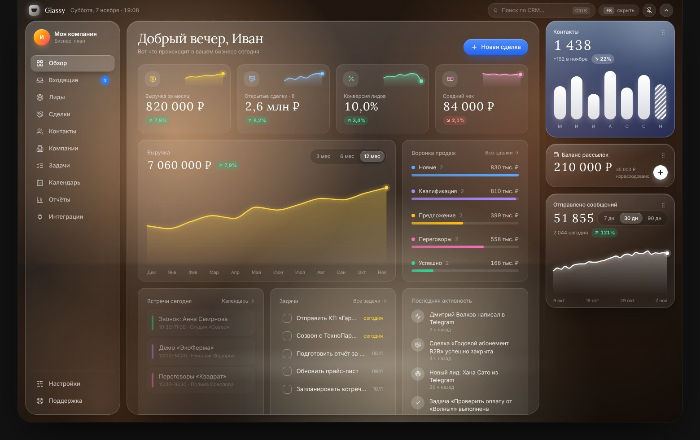

# Glassy Dashboard

Стеклянная CRM-панель для ведения бизнеса — **десктопное приложение для Windows и macOS**.
Живёт в «чёлке» вверху экрана и раскрывается одной клавишей (по умолчанию **F8**).



## Как это работает

- Приложение запускается в фоне: иконка в строке меню (macOS) или в системном трее (Windows), в Dock/панели задач его нет.
- Вверху по центру экрана — маленькая чёрная «чёлка». На MacBook с вырезом она сливается с ним, на Windows выглядит как Dynamic Island.
- **Наведите** на чёлку — она слегка раскроется и покажет ближайшую встречу и число задач на сегодня.
- **Нажмите F8** (в любой программе) или кликните по чёлке — она плавно «вытекает» вниз и превращается в полноценный дашборд.
- **F8 ещё раз / Esc / клик в другое окно** — панель сворачивается обратно в чёлку. Кнопка с булавкой закрепляет панель, чтобы она не пряталась.
- Клавишу можно поменять: *Настройки → Чёлка и горячая клавиша → Изменить*.

## Что внутри

| Раздел | Возможности |
| --- | --- |
| Обзор | Приветствие, KPI с мини-графиками, анимированный график выручки (3/6/12 мес), воронка, встречи и задачи на сегодня, лента активности, команда |
| Входящие | Email / Telegram / WhatsApp в одном списке, ответы, отметки «прочитано» |
| Лиды | Оценка (score), статусы по клику, фильтры, поиск, конвертация лида в сделку |
| Сделки | Канбан-воронка с drag & drop между этапами, суммы и взвешенный прогноз |
| Контакты / Компании | Карточки, теги, копирование email/телефона, объёмы по компаниям |
| Задачи | Приоритеты, сроки, просрочки, анимированные чекбоксы |
| Календарь | Неделя с событиями, линия «сейчас», создание события кликом по сетке, «следующий звонок» |
| Отчёты | Выручка по месяцам, источники лидов (donut), воронка конверсии, рейтинг команды, экспорт CSV |
| Интеграции | Переключатели подключений |
| Настройки | Горячая клавиша, автозапуск, обои (5 пресетов + своё фото), сила размытия стекла, валюта ₽/$/€, резервная копия/восстановление, «начать с чистого листа» |

Справа — виджеты «Контакты», «Баланс рассылок», «Отправлено сообщений». Их можно перетаскивать за ⋮⋮, порядок сохраняется.

Горячие клавиши внутри панели: `Ctrl/⌘ + K` — поиск, `Ctrl/⌘ + 1…0` — разделы, `Esc` — свернуть.

Все данные хранятся **локально** на компьютере. Чтобы перенести их на другое устройство: *Настройки → Сохранить резервную копию*, затем на новом компьютере *Восстановить из файла*.

## Скачать готовые установщики

Сборка для Windows и macOS делается автоматически в GitHub Actions (`.github/workflows/glassy-dashboard.yml`):

1. Откройте вкладку **Actions → «Glassy Dashboard — desktop builds»** и выберите последний успешный запуск.
2. Внизу, в блоке **Artifacts**, скачайте:
   - `Glassy-Dashboard-Windows` → `Glassy-Dashboard-1.0.0-win-x64.exe` (установщик) или `…-portable.exe` (без установки);
   - `Glassy-Dashboard-macOS` → `…-mac-arm64.dmg` для Apple Silicon (M1–M4) или `…-mac-x64.dmg` для Intel.
3. Чтобы получить постоянную ссылку на скачивание, создайте тег: `git tag dashboard-v1.0.0 && git push origin dashboard-v1.0.0` — установщики появятся в **Releases**.

> **macOS:** приложение не подписано сертификатом Apple, поэтому при первом запуске нажмите правой кнопкой → **Открыть** (или *Системные настройки → Конфиденциальность и безопасность → Всё равно открыть*).
> На MacBook F-клавиши по умолчанию управляют яркостью/звуком — нажимайте `fn + F8` или назначьте другую клавишу в настройках.
>
> **Windows:** SmartScreen может предупредить о неизвестном издателе → «Подробнее» → «Выполнить в любом случае».

## Разработка

```bash
cd apps/glassy-dashboard
npm install
npm run dev        # Vite + Electron с горячей перезагрузкой
npm run dev:web    # только интерфейс в браузере (F8 — открыть/закрыть, ?expanded — сразу открытым)
npm run dist:mac   # .dmg (нужен macOS)
npm run dist:win   # .exe (нужен Windows)
```

Стек: Electron 33, React 18, Vite 5, Tailwind CSS 4, framer-motion, lucide-react, zustand. Шрифты Inter и Lora встроены в приложение (работает офлайн).

```
electron/main.cjs     — окно-чёлка, глобальная клавиша, трей, автозапуск
electron/preload.cjs  — безопасный мост window.notch
src/App.jsx           — анимация чёлки (свёрнута → подсказка → панель), переходы страниц
src/components/       — стекло, графики (SVG + framer-motion), сайдбар, виджеты
src/pages/            — разделы CRM
src/lib/store.js      — данные (сохраняются локально), demo-данные в seed.js
```
